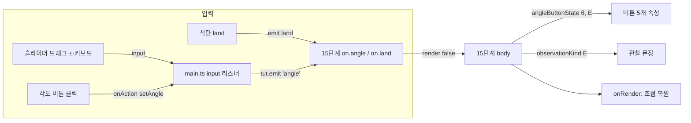

# Implementation Plan: 튜토리얼 실험 단계 각도 버튼 상태

**Branch**: `mission/howitzer-tutorial-angle-buttons` (target/merge: same) | **Date**: 2026-10-25 | **Spec**: [spec.md](spec.md)
**Input**: Feature specification from `kitty-specs/howitzer-tutorial-angle-buttons-01M5RDY7/spec.md` (검토 반영: [spec-review.md](spec-review.md))

## Summary

튜토리얼 15/22단계("실험: 각도만 바꿔 보기")의 각도 버튼 5개에 세 상태(보통·현재·쏜 각도)를 표시하고, 쏜 각도 버튼은 비활성으로 만든다. 4발을 채운 뒤의 관찰 문장은 실제로 기록된 각도만 말하도록 네 가지로 나눈다. 상태와 문장 선택은 `src/model/`의 순수 함수가 정하고, 15단계 본문이 그 결과로 버튼 속성(`aria-pressed`, `disabled`, `aria-label`)과 문장을 그린다. 슬라이더 입력 이벤트를 튜토리얼 이벤트 `angle`로 넘겨 15단계만 스크롤 없이 다시 그린다. 스타일은 15단계 전용 클래스로 두고 공용 `.act`는 바꾸지 않는다. 엔진·계산·의존성은 바꾸지 않는다.

## Technical Context

**Language/Version**: TypeScript 7.0.2 (strict), HTML/CSS — 기존 모노레포 그대로
**Primary Dependencies**: Vite 8.3.5, `@series/engine` (i18n, tutorial — 기존 `emit`·`onRender` 사용, 엔진 변경 없음). 새 의존성 없음
**Storage**: N/A (상태는 15단계 튜토리얼 상태 `s.exp`와 슬라이더 값에서 매번 계산)
**Testing**: Vitest 5.0.5(버튼 상태·관찰 문장 선택 함수), Playwright 1.64.1(15단계 상태·비활성·갱신 경로·접근성·360px 배치, 이전 비교 조정). CI에서 새 e2e 파일은 Chromium·Firefox·WebKit
**Target Platform**: 최신 데스크톱·모바일 브라우저 (Chromium, Firefox, WebKit/iOS Safari)
**Project Type**: web (정적 사이트, 에피소드 한 개 수정)
**Performance Goals**: 슬라이더 드래그 중 카드 다시 그리기가 한 프레임 안 (15단계 본문은 문단·표 하나, `innerHTML` 교체 1회) — SC-002 0.1초
**Constraints**: 360px 가로 스크롤 0·버튼 44×44 이상·한 줄·간격 8px(NFR-001), 대비 4.5:1 / 3:1(NFR-002), 계산 불변(C-001), 공용 `.act` 불변(C-002), 이전 비교 허용 차이 2가지(C-003)
**Scale/Scope**: 파일 수정 6개 + 추가 3개(모델 1, 단위 테스트 1, e2e 1)

## Charter Check

헌장: `.kittify/charter/charter.md` (PRJ-001~010)

| 규칙 | 이 계획에서 | 판정 |
|---|---|---|
| PRJ-001 출처 주석 | 상태 규칙·관찰 문장 조건 옆에 spec FR·answers.md 참조, 버튼 각도는 missions.ts 기존 값 | 준수 |
| PRJ-002 단위 테스트 | `angleButtonState`·`observationKind`를 answers.md 확인표·조합 5가지로 테스트 | 준수 |
| PRJ-003 엔진만 의존 | 에피소드 안에 둠. 엔진은 기존 공개 API(`emit`, `onRender`, `tr`)만 사용 | 준수 |
| PRJ-004 모바일 | 15단계 버튼 5개 44×44 이상, 360px e2e 추가. 다른 `.act`는 Issue #9 | 준수 (범위 밖은 후속 Issue) |
| PRJ-005 수학 오류 시 중단 | 스펙 검토 반영 완료, 남은 모호함 없음 | 준수 |
| PRJ-006 스펙 항목 | 스펙·answers 분리 완료 | 준수 |
| PRJ-007 한/영 | 관찰 문장 4쌍, `aria-label` "이미 쏨 / already fired" | 준수 |
| PRJ-008 PR·CI | 기능 브랜치 → PR, CI check·e2e | 준수 |
| PRJ-009 비밀값 | 해당 없음 | 준수 |

위반 없음 → Complexity Tracking 생략. Phase 1 설계 뒤 재확인: 변화 없음.

## Project Structure

### Documentation (this mission)

```
kitty-specs/howitzer-tutorial-angle-buttons-01M5RDY7/
├── spec.md · answers.md · spec-review.md
├── plan.md            # 이 파일
├── research.md        # 결정 R-1~R-7과 근거
├── data-model.md      # 버튼 상태·관찰 문장 종류
├── quickstart.md      # 확인 방법
└── tasks/             # /spec-kitty.tasks 가 만듦
```

contracts/ 없음 — 외부 API·이벤트가 없는 화면 변경. 튜토리얼 내부 이벤트 `angle`은 data-model.md에 적는다.

### Source Code (repository root)

```
episodes/01-calculus-howitzer/
├── src/
│   ├── model/angle-buttons.ts   # 신규: EXP_ANGLES, angleButtonState(), observationKind() — 순수 계산
│   ├── missions.ts              # 15단계: 버튼 렌더링(상태 속성), on.angle, 관찰 문장 4쌍
│   ├── main.ts                  # ang input → tut.emit('angle'); onRender에서 각도 버튼 초점 복원
│   └── style.css                # .tut-body .exp-angs (15단계 전용 줄·버튼 상태 스타일)
└── tests/angle-buttons.test.ts  # 신규: 상태 확인표·관찰 문장 조합
e2e/
├── angle-buttons.spec.ts        # 신규: 15단계 상태·비활성·갱신 경로·접근성·360px 배치·관찰 문장
├── helpers.ts                   # 15단계까지 가는 함수(walkTutorial 재사용), 비교용 마스킹 함수
└── parity.spec.ts               # 15단계 tutBody에서 각도 버튼 줄·관찰 문장만 양쪽 마스킹
playwright.config.ts             # CI firefox·webkit testMatch 에 angle-buttons 추가
```

**Structure Decision**: 기존 에피소드 구조(`src/model` 순수 계산 + `tests`, 화면은 `missions.ts`·`main.ts`·`style.css`)를 그대로 따른다. 엔진(`engine/`)은 바꾸지 않는다.

## Design Overview



- 15단계가 아닐 때 `emit('angle')`은 그 단계에 `on.angle`이 없으므로 아무것도 다시 그리지 않는다 (엔진 `emit`: 핸들러 없으면 return) → 다른 단계 화면·이전 비교 영향 없음
- 각도 버튼 클릭은 엔진이 이미 `onAction` 뒤 `render(false)`를 부르고, `setAngle`의 input 이벤트로 `emit('angle')`도 한 번 더 그린다. 결과가 같으므로 무해 (R-3)

## Implementation Concern Map

> 작업 패키지는 "계산 + 그 계산을 쓰는 화면"을 한 묶음으로 나눈다 (docs/agents/main.md 5절).

### IC-01 — 버튼 상태 계산과 15단계 버튼 표시

- **Purpose**: 기록·슬라이더 각도로 버튼 상태를 정하고, 15단계 버튼에 상태 속성·전용 스타일·즉시 갱신·초점 복원을 붙인다
- **Relevant requirements**: FR-001~FR-006, NFR-001, NFR-002, NFR-003, C-002, C-005
- **Affected surfaces**: `src/model/angle-buttons.ts`(angleButtonState), `tests/angle-buttons.test.ts`, `src/missions.ts`, `src/main.ts`, `src/style.css`, `e2e/angle-buttons.spec.ts`, `e2e/helpers.ts`, `playwright.config.ts`
- **Sequencing/depends-on**: none
- **Risks**: 15단계 tutBody가 바뀌어 이전 비교가 이 시점부터 실패 → 같은 묶음에서 parity 마스킹(버튼 줄)을 함께 넣어야 `pnpm test:e2e`가 통과. 287px(클래식 스크롤바)에서 한 줄 유지

### IC-02 — 관찰 문장 선택과 표시

- **Purpose**: 4발 뒤 관찰 문장을 기록에 맞는 네 가지 중 하나로 고른다
- **Relevant requirements**: FR-007, SC-005, C-003 ②, C-005
- **Affected surfaces**: `src/model/angle-buttons.ts`(observationKind), `tests/angle-buttons.test.ts`, `src/missions.ts`, `e2e/angle-buttons.spec.ts`, `e2e/parity.spec.ts`(관찰 문장 마스킹)
- **Sequencing/depends-on**: IC-01 (같은 파일·같은 e2e 진행 함수)
- **Risks**: "둘 다" 문장은 지금 문장과 글자까지 같아야 함 (5발 시나리오로 확인). 자동 진행 기록 {30,40,45,50}은 "40·45·50만" 문장이 나와 legacy와 다름 → 마스킹 필요
