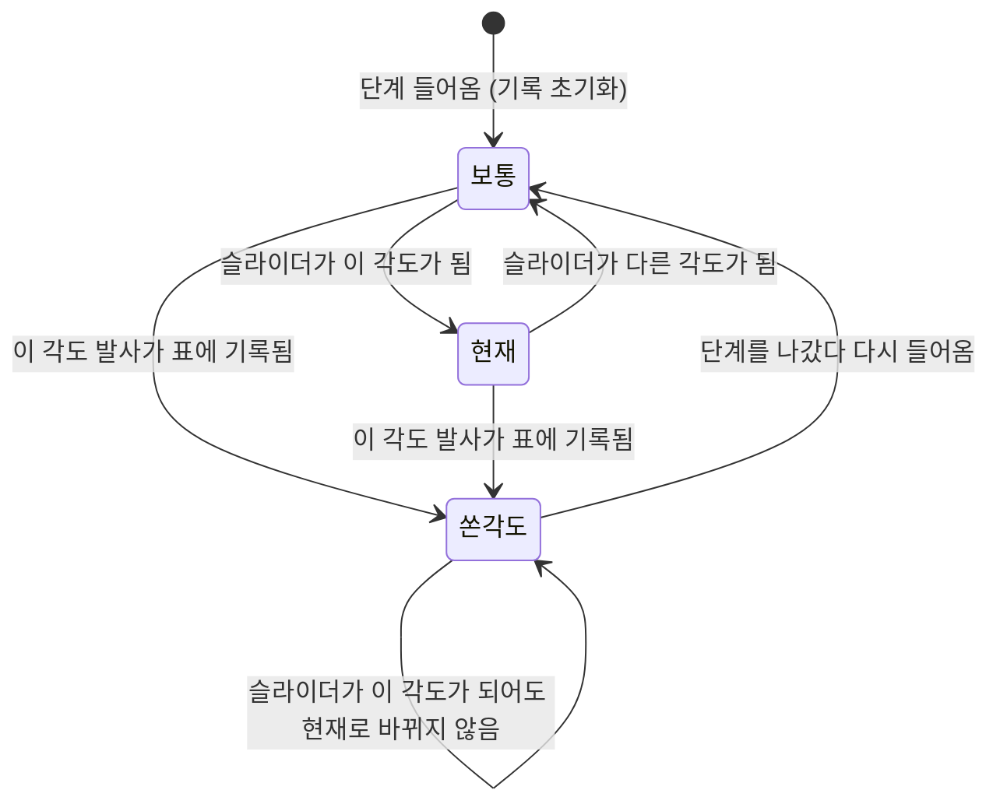

# Mission Specification: 튜토리얼 실험 단계 각도 버튼 상태

**Mission Branch**: `mission/howitzer-tutorial-angle-buttons`  
**Created**: 2026-10-25  
**Status**: Draft (스펙 검토 반영 2026-10-25)  
**Input**: Issue #4 (사람 제안·채택) — 미적분 자주포 튜토리얼 15/22단계(4장 "실험: 각도만 바꿔 보기")의 각도 버튼 5개(30·40·45·50·60°)에 상태 표시. 지금 슬라이더 각도와 같은 버튼은 강조, 이미 쏴서 기록된 각도의 버튼은 회색·완전 비활성. 360px 터치에서도 구분. 계산 변경 없음

## Episode Design *(기존 에피소드 01-calculus-howitzer 개선: 바뀌는 항목만 작성)*

### 1. Role Setting

N/A — 역할(자주포 포수)과 상황은 그대로다.

### 2. Math Concepts

- 발사각과 사거리의 관계 (튜토리얼 4장 "실험: 각도만 바꿔 보기"). 계산과 설명은 바뀌지 않는다
- 선수 지식: 없음

### 3. Learning Goals *(at most 3)*

1. 학습자가 실험한 각도와 남은 각도를 한눈에 구분해, 버튼 고르기보다 **각도에 따른 사거리 변화를 관찰하는 데** 집중하며 서로 다른 각도 4개로 실험을 빠르게 끝낸다

### 4. Core Interaction

15단계에 들어오면 장약이 2호(포구속도 75 m/s, [게임용 값] — 실제 자주포는 수백 m/s, `src/model/constants.ts`)로 맞춰진다. 장약 버튼은 잠기지 않으며, **2호로 쏴서 화면 안에 떨어진 발만** 결과 표에 기록된다. 카드에 각도 버튼 5개(30·40·45·50·60°)가 있다. 버튼을 누르면 슬라이더가 그 각도로 맞춰지고, 학습자가 발사한다. 이 단계는 서로 다른 각도 4발이 기록되어야 넘어갈 수 있다.

바뀌는 것은 버튼 5개의 **모습과 누를 수 있는지**, 그리고 4발을 채운 뒤 나오는 관찰 문장(아래 "관찰 문장")뿐이다. 버튼마다 세 상태 중 하나다.

| 상태 | 조건 | 보이는 모습 (두 테마 공통) | 누를 수 있나 |
|---|---|---|---|
| 보통 | 아래 둘 다 아님 | 지금과 같음: 배경색 바탕 + 파랑 테두리·파랑 글자 | 예 |
| 현재 | 슬라이더 각도 = 버튼 각도, 그리고 쏜 각도가 아님 | **진한 글자색(ink)으로 채움 + 배경색 글자**. 채움 자체가 색 외 단서다. 주황(accent) 채움 + 흰 글자는 대비 미달이라 쓰지 않는다 | 예 |
| 쏜 각도 | 그 각도가 이 단계의 결과 표에 기록됨 | **회색(선 색) 채움 + 흐린(muted) 글자**. 글자색만 바꾸거나 투명도(opacity)로 흐리게 하지 않는다 (흑백에서 '보통'과 구분되지 않거나 대비 미달) | **아니오** (완전 비활성: 터치·클릭·키보드 모두 무반응, 탭 순서에서 빠짐) |

- "현재" 표시는 슬라이더 드래그, ± 버튼, 각도 버튼, 키보드 등 **어떤 방법으로** 각도를 바꿔도 곧바로 따라 바뀐다
- 360px 휴대폰에서 버튼 5개는 **한 줄**에 놓이고, 각각 44×44 CSS px 이상, 버튼 사이 8px 이상이다. 버튼 폭은 카드 내용 폭에 맞춰 나눠 가져 한 줄을 유지한다 (PRJ-004, 검증: answers.md V1)

**관찰 문장** (4발을 채운 뒤, 기록된 각도에 맞춰 보여 준다 — 사람 결정 2026-10-25, 검토 R3 ②):

지금은 4발을 채우면 기록과 상관없이 "40°·45°·50°는 거리가 거의 같고, 30°와 60°도 서로 비슷하죠?"라고 단정한다. 30·40·45·50으로 끝낸 학습자는 60°를 쏘지 않았는데 화면이 60°를 봤다고 말하게 된다. 바꾼 뒤에는 기록에 있는 각도만 말한다.

| 기록에 있는 각도 | 한국어 | English |
|---|---|---|
| 40·45·50 모두, 30·60 모두 | 40°·45°·50°는 거리가 **거의 같고**, 30°와 60°도 서로 **비슷하죠?** (땅 높낮이 때문에 조금씩 달라요) 왜 그런지 다음 단계에서 봐요. | 40°, 45° and 50° land **almost the same** distance, and 30° and 60° are **similar** too, right? (Uneven ground makes them differ a little.) We’ll see why next. |
| 40·45·50 모두, 30·60 중 하나 이하 | 40°·45°·50°는 거리가 **거의 같죠?** (땅 높낮이 때문에 조금씩 달라요) 왜 그런지 다음 단계에서 봐요. | 40°, 45° and 50° land **almost the same** distance, right? (Uneven ground makes them differ a little.) We’ll see why next. |
| 30·60 모두, 40·45·50 중 하나 이상 빠짐 | 30°와 60°는 거리가 서로 **비슷하죠?** (땅 높낮이 때문에 조금씩 달라요) 왜 그런지 다음 단계에서 봐요. | 30° and 60° land a **similar** distance, right? (Uneven ground makes them differ a little.) We’ll see why next. |
| 그 밖 | 각도에 따라 날아간 거리가 어떻게 달라졌는지 표에서 비교해 보세요. 왜 그런지 다음 단계에서 봐요. | Compare in the table how the distance changed with the angle. We’ll see why next. |

- 첫 줄은 지금 문장과 글자 하나까지 같다 (이전 비교 테스트가 그대로 확인할 수 있게)
- 기록은 버튼 각도가 아닌 값(예: 37.5°)을 포함할 수 있다. 위 조건은 해당 버튼 각도가 기록에 있는지만 본다

### 5. Staged Missions

N/A — 튜토리얼 단계와 진행 조건(서로 다른 각도 4발)은 바뀌지 않는다. 문구는 위 "관찰 문장"만 바뀐다.

### 6. Answers and Verification

See `answers.md` in this folder. *(Do not copy answers into this file.)*

- V1. 360px 화면에서 튜토리얼 카드 안쪽(내용) 폭은 몇 px이고, 44px 이상 버튼 5개가 8px 간격으로 한 줄에 들어가는가? 버튼 하나의 폭은 최대 몇 px까지 허용되는가?

### 7. References

| Item | Source | URL | Verified? |
|------|--------|-----|-----------|
| 실험 각도 버튼 30·40·45·50·60° | `episodes/01-calculus-howitzer/src/missions.ts` 4장 실험 단계 | — | yes |
| 2호 장약 포구속도 75 m/s | `episodes/01-calculus-howitzer/src/model/constants.ts` `CHARGES` [게임용 값] | — | yes (게임용 값) |
| 터치 대상 44×44 CSS px | WCAG 2.2 SC 2.5.5 Target Size (Enhanced), **Level AAA**. 이 프로젝트는 헌장 PRJ-004로 44px를 요구 (AA 기준 2.5.8은 24×24) | https://www.w3.org/WAI/WCAG22/Understanding/target-size-enhanced.html | yes |
| 색만으로 정보 전달 금지 | WCAG 2.2 SC 1.4.1 Use of Color | https://www.w3.org/WAI/WCAG22/Understanding/use-of-color.html | yes |
| 글자 대비 4.5:1, 비활성 요소 예외 | WCAG 2.2 SC 1.4.3 Contrast (Minimum) | https://www.w3.org/WAI/WCAG22/Understanding/contrast-minimum.html | yes |

### 8. Difficulty

1 — 튜토리얼 화면의 버튼 표시와 관찰 문장 하나만 바뀐다. 학습 내용·계산은 그대로.

## User Scenarios & Testing *(mandatory)*

### User Story 1 - 쏜 각도는 다시 누르지 못한다 (Priority: P1)

학습자가 각도 버튼으로 실험하다 보면 어느 각도를 이미 쐈는지 헷갈려 같은 각도를 또 쏘게 된다. 같은 각도는 진행 조건(서로 다른 4각도)에 보탬이 안 된다. 쏜 각도의 버튼이 회색으로 꺼지면 남은 각도만 고르면 된다.

**Why this priority**: Issue #4의 핵심 목적(실험을 빨리 끝내기)을 직접 해결한다.

**Independent Test**: 15단계에서 30° 버튼 → 발사 → 착탄 후 30° 버튼이 회색이고 눌러도 슬라이더가 바뀌지 않는지 확인.

**Acceptance Scenarios**:

1. **Given** 15단계에 막 들어옴, **When** 아무것도 쏘지 않음, **Then** 다섯 버튼 모두 누를 수 있다 (슬라이더 각도와 같은 버튼은 "현재")
2. **Given** 30° 버튼을 누르고 발사, **When** 포탄이 화면 안에 떨어져 표에 30.0°가 기록됨, **Then** 30° 버튼은 회색·비활성이 되고 나머지 네 버튼은 누를 수 있다
3. **Given** 30° 버튼이 회색, **When** 학습자가 30° 버튼을 누름(터치·클릭), 또는 키보드로 그 버튼에 가려 함, **Then** 아무 일도 일어나지 않는다 (슬라이더 각도 그대로, 탭 순서에서 그 버튼을 건너뜀)
4. **Given** 표에 4각도가 기록돼 "다음"이 켜짐, **When** 카드를 봄, **Then** 그 4개 버튼은 회색이고 남은 1개는 누를 수 있다
5. **Given** 30° 버튼이 회색, **When** 학습자가 슬라이더나 ± 버튼으로 30°를 맞춰 발사, **Then** 막지 않는다. 결과 표·진행 조건은 지금과 같이 동작한다

---

### User Story 2 - 지금 각도의 버튼이 강조된다 (Priority: P2)

학습자는 지금 슬라이더가 어느 버튼 각도에 있는지 카드에서 바로 본다.

**Why this priority**: 각도를 바꿨는지 확인하는 데 도움이 되지만, 비활성(P1) 없이도 진행에는 지장이 없다.

**Independent Test**: 15단계에서 슬라이더를 40°로 옮기면 40° 버튼만 "현재", 40.5°로 옮기면 "현재" 버튼이 없는지 확인. 버튼 클릭뿐 아니라 **드래그·± 버튼·키보드 화살표** 각각으로 확인한다.

**Acceptance Scenarios**:

1. **Given** 15단계, 슬라이더 45°, **When** 카드를 봄, **Then** 45° 버튼만 "현재"다
2. **Given** 슬라이더 45°, **When** 50° 버튼을 누름, **Then** 50° 버튼이 "현재", 45° 버튼은 "보통"이 된다
3. **Given** 슬라이더 50°, **When** ± 버튼, 드래그, 또는 키보드 화살표로 50.5°가 됨, **Then** "현재" 버튼이 하나도 없다. 다시 50°로 오면 50° 버튼이 "현재"가 된다. 이때 화면이 스크롤되거나 튀지 않는다
4. **Given** 슬라이더 40°이고 40°가 이미 기록됨, **When** 카드를 봄, **Then** 40° 버튼은 "쏜 각도"(회색·비활성)로만 보이고, "현재" 버튼은 하나도 없다

---

### User Story 3 - 휴대폰·보조 기술에서도 구분된다 (Priority: P3)

360px 휴대폰 터치 학습자와 화면 읽기 프로그램 사용자도 세 상태를 구분할 수 있다.

**Why this priority**: 헌장 PRJ-004(360px·44px)와 접근성 기본.

**Independent Test**: 360px 터치 환경에서 15단계 버튼 5개의 크기·간격·배치를 재고, 접근성 트리에서 상태와 이름을 확인.

**Acceptance Scenarios**:

1. **Given** 360px 폭 휴대폰, **When** 15단계 카드를 봄, **Then** 버튼 5개가 한 줄에 있고, 각각 44×44 CSS px 이상, 서로 8px 이상 떨어져 있으며, 가로 스크롤이 없다
2. **Given** 화면 읽기 프로그램, **When** 탐색 모드로 버튼들을 읽음, **Then** "현재" 버튼은 선택됨(눌림)으로, "쏜 각도" 버튼은 "30°, 이미 쏨" / "30°, already fired"처럼 이유가 담긴 이름과 함께 비활성(사용 불가)으로 읽힌다
3. **Given** 밝은·어두운 테마, 흑백 보기, **When** 카드를 봄, **Then** 세 상태가 채움 차이(보통 = 바탕색, 현재 = 진한 채움, 쏜 각도 = 회색 채움)로도 구분된다

### Edge Cases

- 포탄이 화면 밖으로 나감 → 표에 기록되지 않으므로 그 각도 버튼은 계속 누를 수 있다 (사람 결정 2026-10-25)
- 다른 장약으로 바꿔 쏨 → 기록되지 않으므로 버튼 상태도 바뀌지 않는다
- 슬라이더가 버튼 각도가 아닌 값(예: 37.5°)에서 발사해 표에 기록됨 → 어느 버튼도 회색이 되지 않는다. 진행 조건에는 지금처럼 들어간다
- 같은 각도를 슬라이더로 다시 쏨 → 막지 않는다 (사람 결정 2026-10-25). 표·진행 조건 동작은 지금과 같다
- 단계를 "이전"으로 나갔다 다시 들어옴 → 지금처럼 기록이 초기화되고 버튼은 모두 다시 켜진다
- 카드 안 버튼을 누른 뒤 카드가 다시 그려짐 → 페이지가 멈추거나 카드·화면이 스크롤되지 않는다. 슬라이더는 카드 밖이라 드래그·키보드 조작 중 초점을 잃지 않는다
- 언어 전환 → 버튼 상태가 유지되고, 접근성 이름과 관찰 문장도 그 언어로 바뀐다
- 포탄이 날아가는 중(발사 버튼이 꺼진 동안) → 버튼 상태 규칙은 같다. 착탄해 기록되는 순간 회색이 된다

## Requirements *(mandatory)*

### Functional Requirements

| ID | Title | User Story | Priority | Status |
|----|-------|------------|----------|--------|
| FR-001 | 쏜 각도 비활성 | 학습자로서, 15단계 결과 표에 기록된 각도의 버튼이 회색 채움으로 바뀌고 터치·클릭·키보드 어느 것으로도 눌리지 않기(탭 순서에서도 빠짐)를 원한다. 같은 각도를 또 쏘지 않도록. "기록된 각도"는 결과 표에 행이 있는 각도만이다 (화면 밖 포탄·다른 장약 제외) | High | Open |
| FR-002 | 현재 각도 강조 | 학습자로서, 슬라이더 각도와 정확히 같은 각도의 버튼이 진한 채움으로 강조되기를 원한다. 지금 어느 각도인지 카드에서 보도록 | Medium | Open |
| FR-003 | 즉시 갱신 | 학습자로서, 슬라이더 드래그·± 버튼·각도 버튼·키보드 등 어떤 방법으로 각도를 바꾸거나 착탄이 기록되면 버튼 상태가 곧바로 따라 바뀌기를 원한다. 갱신 때문에 화면이 스크롤되지 않는다 | High | Open |
| FR-004 | 상태 우선순위 | 학습자로서, 한 버튼이 "현재"이면서 "쏜 각도"이면 "쏜 각도"(회색·비활성)로만 보이기를 원한다. 누를 수 없는 버튼이 강조되어 헷갈리지 않도록 | Medium | Open |
| FR-005 | 다른 조작은 그대로 | 학습자로서, 슬라이더·± 버튼·발사 버튼·장약 버튼·결과 표·진행 조건이 지금과 똑같이 동작하기를 원한다. 이번 변경은 각도 버튼 5개의 표시·누를 수 있는지와 FR-007의 관찰 문장만 바꾼다 | High | Open |
| FR-006 | 보조 기술 전달 | 화면 읽기 사용자로서, "현재" 버튼은 선택됨(눌림)으로, "쏜 각도" 버튼은 비활성이면서 이유가 담긴 이름("30°, 이미 쏨" / "30°, already fired")으로 전달되기를 원한다. 보통·현재 버튼의 이름은 지금처럼 각도("30°")다 | Medium | Open |
| FR-007 | 관찰 문장 | 학습자로서, 4발을 채운 뒤 나오는 관찰 문장이 내가 실제로 쏜 각도만 말하기를 원한다 (§4 "관찰 문장" 표). 쏘지 않은 각도를 봤다고 단정하지 않도록 | High | Open |

### Non-Functional Requirements

| ID | Title | Requirement | Category | Priority | Status |
|----|-------|-------------|----------|----------|--------|
| NFR-001 | 터치 크기·배치 | 360px 폭(오버레이·클래식 스크롤바 모두)에서 각도 버튼 5개가 ① 각각 44×44 CSS px 이상 ② 한 줄(모두 같은 세로 위치) ③ 이웃 버튼 사이 8px 이상 ④ 페이지·카드에 가로 스크롤 없음. 버튼 폭은 고정 글자 폭이 아니라 카드 내용 폭을 나눠 가지는 방식이어야 287px(클래식 스크롤바)에서도 한 줄이 된다 (PRJ-004, answers.md V1) | Usability | High | Open |
| NFR-002 | 색 외 단서·대비 | 세 상태가 채움(바탕색 / 진한 채움 / 회색 채움)으로 구분된다. 밝은·어두운 테마 모두에서 보통·현재 버튼 글자 대비 4.5:1 이상, 쏜 각도 버튼 글자 대비 3:1 이상 (비활성 요소는 WCAG 1.4.3 예외지만 읽혀야 함). 쏜 각도는 투명도로 흐리게 하지 않는다 | Accessibility | Medium | Open |
| NFR-003 | 브라우저 | FR-001~FR-004와 NFR-001을 확인하는 브라우저 테스트가 Chromium(로컬·CI)과 CI의 Firefox·WebKit에서 모두 실행되어 통과한다 (현재 CI의 Firefox·WebKit은 일부 테스트 파일만 실행하므로, 새 테스트가 그 대상에 들어가야 함). 15단계까지 튜토리얼을 진행하는 시간을 감안해 테스트 시간 제한을 정한다 | Reliability | Medium | Open |

### Constraints

| ID | Title | Constraint | Category | Priority | Status |
|----|-------|------------|----------|----------|--------|
| C-001 | 계산 불변 | 탄도·지형·조준 계산과 결과 표 값은 바꾸지 않는다 | Technical | High | Open |
| C-002 | 범위 | 튜토리얼 15단계의 각도 버튼 5개와 관찰 문장만 바꾼다. 다른 단계의 버튼("θ = … 넣기", 장약 올리기·내리기)과 엔진의 공용 튜토리얼 버튼 모양(`.act`)은 바꾸지 않는다 — 15단계 버튼에만 적용되는 별도 표시 규칙을 둔다. 다른 버튼의 44px 미달은 후속 Issue #9 (사람 결정 2026-10-25) | Technical | High | Open |
| C-003 | 이전 비교 | 이전 버전 비교 테스트에서 허용하는 차이는 15단계 카드 본문의 ① 각도 버튼 5개의 상태 표시(모양·비활성·접근성 속성) ② FR-007 관찰 문장뿐이다. 그 밖의 15단계 본문(설명, 결과 표)과 다른 모든 단계·화면·점수·HUD는 지금처럼 똑같아야 한다. 비교 테스트가 이 두 가지만 정확히 걸러 내도록 고친다 | Technical | High | Open |
| C-004 | 의존 규칙 | 에피소드는 `@series/engine`만 import한다 (PRJ-003). 엔진을 바꿔야 하면 계획에서 근거를 남긴다 | Technical | High | Open |
| C-005 | 문구 | 새로 생기는 학습자용 문구(관찰 문장, 보조 기술용 이름)는 한국어·영어 둘 다 (PRJ-007) | Business | Medium | Open |

### Key Entities

- **실험 기록**: 15단계에서 화면 안에 떨어진 2호 장약 발사의 {발사각, 날아간 거리} 목록. 단계에 들어올 때 비워진다. 결과 표, 진행 조건, 버튼 "쏜 각도" 상태, 관찰 문장이 모두 이것을 기준으로 한다
- **각도 버튼**: 30·40·45·50·60° 다섯 개. 상태는 보통·현재·쏜 각도 중 하나

## Success Criteria *(mandatory)*

### Measurable Outcomes

- **SC-001**: 15단계에서 각도 버튼만 써서 진행하는 학습자는 정확히 4발로 "다음"이 켜진다 (같은 각도를 버튼으로 두 번 쏠 수 없음)
- **SC-002**: 어떤 방법으로 각도를 바꾸거나 착탄이 기록되든, 다음 화면 갱신 안에(사람이 지연을 느끼지 않게, 0.1초 이내) 버튼 상태가 맞게 바뀐다
- **SC-003**: 360px 터치 휴대폰에서 다섯 버튼이 한 줄, 각각 44×44 CSS px 이상, 간격 8px 이상이고, 세 상태를 색 없이도 구분할 수 있다
- **SC-004**: 이전 비교 테스트에서 C-003이 허용한 두 가지 외의 차이가 0건이다
- **SC-005**: 4발을 채운 뒤의 관찰 문장이 기록에 없는 버튼 각도를 언급하는 경우가 0건이다 (§4 표의 네 경우 모두 확인)

## Planning Notes *(스펙 검토 반영 — 계획에서 정할 것)*

스펙 검토(`spec-review.md`)가 지금 코드에서 확인한 사실. 구현 방법은 계획에서 정하되 아래를 빠뜨리지 않는다.

- R4: 튜토리얼 카드는 게임 이벤트와 카드 안 클릭에서만 다시 그려진다. 슬라이더 드래그·± 버튼·키보드(슬라이더의 입력 이벤트)는 지금 카드를 다시 그리지 않으므로, FR-003을 위해 이 경로를 추가해야 하고 스크롤하지 않는 방식이어야 한다
- R5: 저장소의 비활성 관례는 브라우저 기본 비활성(초점 불가)이다. US3-2는 이 관례에 맞춰 "탐색 모드에서 읽힘"으로 썼다
- R6: CI의 Firefox·WebKit 실행 대상 파일, 360px 검사 위치, 15단계까지 진행하는 테스트의 시간 제한을 계획에 적는다
- R7: 이전 비교 테스트는 단계마다 카드 본문 HTML 전체를 비교한다. 15단계에서 C-003의 두 가지만 걸러 내는 방식을 정한다. 자동 진행은 legacy와 같은 순서(30→40→45→50)로 버튼을 누르므로 진행 시점은 같다
- R10: 15단계 버튼은 다른 단계와 같은 공용 버튼 표시를 쓴다. C-002를 지키려면 15단계 버튼에만 적용되는 표시 규칙이 필요하다

## Assumptions

- "슬라이더 각도와 같다"는 슬라이더 값(0.5° 단위, 10 + 0.5k라 이진 정확값)과 버튼 각도가 숫자로 정확히 같을 때다. 근처 값(예: 29.5°)은 "현재"가 아니다
- 슬라이더로 같은 각도를 다시 쏘는 것은 막지 않는다 (사람 결정, 결정 기록 DM-01M5RDYKQP79NB9KMPBWD2NDFP)
- "쏜 각도"는 결과 표에 기록된 발사만이다 (사람 결정, 결정 기록 DM-01M5RDYP6VC7MK9NYTBHZADJ4G)
- 44×44px 기준을 이번 5개 버튼에 맞추는 것은 사람이 의도 요약에서 승인했다 (2026-10-25). 다른 튜토리얼 버튼은 Issue #9
- 관찰 문장을 기록에 맞추는 것(검토 R3 ②)은 사람이 골랐다 (2026-10-25). 진행 조건에 30·60을 넣지는 않는다
- 320px 등 360px보다 좁은 화면은 헌장 기준 밖이다. 그 폭에서 두 줄로 넘어가는 것은 허용한다
